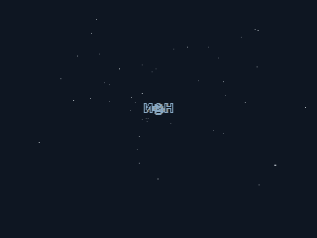
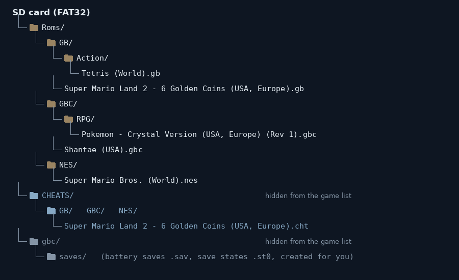
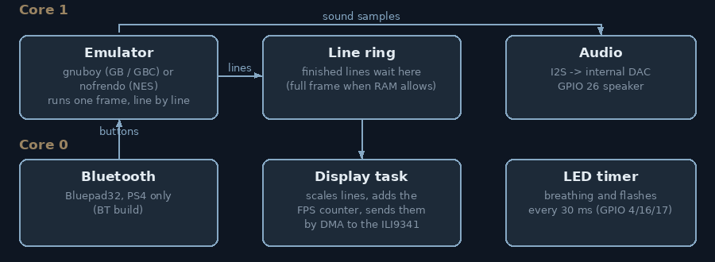

# H@N-CYD-GBC

**Game Boy, Game Boy Color and NES emulator for the ESP32 "Cheap Yellow Display" (CYD):
the ESP32-2432S024C (2.4") and, new, both 2.8" boards: the ESP32-2432S028R and the two-USB "CYD2USB"**,
with PS4 Bluetooth controllers, save states, cheats, menu themes, an A–Z game list, board LED effects
and a one-click web flasher.

<p align="center"></p>

> [!WARNING]
> **Use the build for your exact board** (see [Supported boards](#supported-boards)). Other "CYD"
> boards (ESP32-S3 boards, the 3.5" ESP32-3248S035, capacitive 2.8" boards...) use different chips,
> screens or pins. The firmware won't work on them and will most likely show a
> blank screen.

**Flash it from your browser:** <https://hackatnight.com/HAN-CYD-GBC/>

---

## Contents

- [Supported boards](#supported-boards)
- [Features](#features)
- [Quick start](#quick-start)
- [Flashing in detail](#flashing-in-detail)
- [Setting up the SD card](#setting-up-the-sd-card)
- [Sending games over USB](#sending-games-over-usb)
- [Using it](#using-it): game list, A–Z jump, controls, pause menu, save states, cheats, settings, themes, LED
- [How it works](#how-it-works)
- [Troubleshooting](#troubleshooting)
- [Building from source](#building-from-source)
- [Credits and licenses](#credits-and-licenses)

> The menu pictures in this README are illustrations drawn from the firmware's own layout and colors,
> not photos of the screen. The boot and loading animations were rendered by the firmware's own
> wireframe code.

---

## Supported boards

| Board | Screen / touch | Status | Builds |
|---|---|---|---|
| **ESP32-2432S024C** | 2.4" ILI9341, CST820 **capacitive** touch | Main board, tested daily | Bluetooth (PS4), Touch-only |
| **ESP32-2432S028R** | 2.8" ILI9341, XPT2046 **resistive** touch, one micro-USB port (the original "Cheap Yellow Display") | **New in 2.11.0: needs testers** | Bluetooth (PS4) with touch |
| **ESP32-2432S028 "CYD2USB"** | Same 2.8" board with **two USB ports** (micro-USB + USB-C), usually an ST7789 screen | **New in 2.12.0: needs testers** | Bluetooth (PS4) with touch |

Both are the classic ESP32 (dual core, 240 MHz, 4 MB flash, no PSRAM) with a microSD slot, a speaker connector
and an RGB LED, so every feature works on both. The 2.8" board differs only in its backlight pin and its touch chip.

### Testing the 2.8" ESP32-2432S028R build

This build has passed every check I could run without the board in hand, but nobody has run it on a real 2.8" board
yet. If you have one, please try it and
**[send a quick board test report](https://github.com/hackatnight/HAN-CYD-GBC/issues/new?template=board-test.md)**.

The checks run so far:
- It compiles, and every pin matches the board's published pin map with no clashes.
- The touch chip is read in software on its own pins, so it never shares a connection with the SD card.
- [`tools/touchtest`](tools/touchtest) runs the firmware's touch calibration against simulated resistive panels, in
  all 8 ways the touch layer can be wired and all 4 screen orientations. Taps land within 1.4 px, and a bad
  calibration is always refused.

What to expect:
1. **First start:** after the boot animation, it asks you to **tap four crosses** to calibrate the touch screen.
   A resistive screen needs this once; it's saved after that. *Setup → Display & touch → Calibrate touch* redoes it.
2. **It starts in portrait** with on-screen buttons, so it can be played by touch right away. If the picture is
   upside down, **hold BOOT for 1 second** on the game list to rotate it. Pair a PS4 controller to play in
   landscape.
3. Everything else (SD card, sound, LED, USB transfer, cheats, saves) is the same as on the 2.4" board.

**Which 2.8" build?** Count the USB ports.
- **One** micro-USB port: the **ESP32-2432S028R** build.
- **Two** ports (micro-USB and USB-C): the **CYD2USB** build.

The two-USB board is the same board with a different screen chip on most units: an ST7789 instead of an ILI9341,
with colors that come out inverted. Not every unit is the same, so both 2.8" builds have a
**Setup → Display & touch → Screen chip** switch (ILI9341 / ST7789).
- If the colors look wrong, washed out or like a photo negative, flip **Screen chip** and **Invert colors**
  until the picture looks right. Everything else is identical.
- The CYD2USB build starts with ST7789 and inverted colors; the S028R build starts with ILI9341, no inversion.
- Holding **BOOT** while powering on puts those defaults back.

---

## Features

| | |
|---|---|
| **Systems** | Game Boy (`.gb`), Game Boy Color (`.gbc`), NES (`.nes`, most licensed games) |
| **Speed** | Full speed (60 fps emulated, 50 for PAL NES), sound through the board's speaker |
| **Games** | Read from a microSD card, organized in any folders you like, thousands per folder |
| **Two builds** | Bluetooth (PS4 controller, landscape) or touch-only (on-screen buttons, portrait, more game space) |
| **Saving** | Battery saves written automatically, plus one save state per game for every system |
| **Cheats** | GameShark / Pro Action Replay codes from `.cht` files, a built-in cheat finder, and a ready-made pack for 2,572 games |
| **Game list** | Folders, scrolling long names, A–Z jump (letter strip in landscape, letter grid in portrait) |
| **Shortcuts** | Continue your last game in one tap, plus Favorites, Recent and Most played lists at the top |
| **Looks** | Code-drawn wireframe boot and loading screens, 4 menu themes, animated menus |
| **LED** | The board's RGB LED: solid or breathing in any color, blinks on saves and cheats |
| **Big games** | Up to 8 MB: what doesn't fit in flash is read from the SD card while you play |
| **Menu music** | Two original chiptune loops in the menus, with their own on/off and volume |
| **USB transfer** | Send games from the web page straight to the SD card over the USB cable, sorted into the right folder |

---

## Quick start

You need:

- an **ESP32-2432S024C** or **ESP32-2432S028R** board
- a **microSD card** (any size; it gets formatted FAT32)
- a **USB cable that carries data** (some cables only charge)
- **Chrome or Edge on a computer**, for the web flasher
- optional: a **PS4 (DualShock 4) controller**, for the Bluetooth build
- your own game files (`.gb`, `.gbc`, `.nes`). This project doesn't include or link to any games.

Steps:

1. **Pick a build.** On the **ESP32-2432S024C**:
   - **Bluetooth:** best with a PS4 controller. Starts in landscape and has 2.9 MB of flash for games.
   - **Touch-only:** plays with on-screen buttons in portrait. It has 3.25 MB of flash for games and more free memory.

   On a **2.8" board**, use the 2.8" build that matches your USB ports: one port = **ESP32-2432S028R**, two ports =
   **CYD2USB** (touch and Bluetooth, 2.9 MB for games). See
   [Testing the 2.8" build](#testing-the-28-esp32-2432s028r-build).
2. **Flash it:** open the **[web flasher](https://hackatnight.com/HAN-CYD-GBC/)**, plug the board in, click
   *Install*, pick the board's port, choose *Erase* and wait about a minute.
3. **Prepare the SD card:** format it FAT32 and create `Roms/GB`, `Roms/GBC` and `Roms/NES`, then copy your
   games into them. Optional: unzip the [cheat pack](docs/cheats/HAN-CHEATS-GB-GBC-NES.zip) to the root of the card.
4. **Power on:** insert the card and press RST. After the boot animation you'll see your folders.
5. **Bluetooth build only:** open *Setup → Controller (Bluetooth) → Pair new controller*. Then hold
   **SHARE + PS** on the PS4 controller until its light bar flashes quickly.
6. **Tap a game.** The first launch copies it into the board's flash, with a progress bar. After that it starts instantly.

---

## Flashing in detail

Both builds are a single **merged image** that goes at address **0x0**. It contains the bootloader, the
partition table and the app, so no other files are needed. Flashing a merged image also clears saved settings
and controller pairings. Your saves are on the SD card and aren't touched.

### Option 1: web flasher (easiest)

Open **<https://hackatnight.com/HAN-CYD-GBC/>** in Chrome or Edge on a computer. The page uses
[ESP Web Tools](https://esphome.github.io/esp-web-tools/) and has both builds built in.

1. Click **Install Bluetooth build** or **Install touch-only build**.
2. Pick the board in the port list. It's usually *USB-SERIAL CH340* or *CP210x*. If nothing shows up, install the
   [CH340 driver](https://www.wch-ic.com/downloads/CH341SER_ZIP.html), replug the board and try again.
3. Tick **Erase device** the first time, then **Install**.
4. When it says done, press **RST** on the board.

If it can't connect, hold **BOOT**, tap **RST**, let go of BOOT and click Install again.

### Option 2: esptool (command line)

The images are in [`docs/firmware/`](docs/firmware):

```sh
pip install esptool
esptool.py --chip esp32 --baud 921600 write_flash 0x0 HAN-CYD-GBC-BT.bin
# or
esptool.py --chip esp32 --baud 921600 write_flash 0x0 HAN-CYD-GBC-touch.bin
# ESP32-2432S028R (2.8", one USB port):
esptool.py --chip esp32 --baud 921600 write_flash 0x0 HAN-CYD-GBC-2432S028R.bin
# 2.8" with two USB ports (CYD2USB):
esptool.py --chip esp32 --baud 921600 write_flash 0x0 HAN-CYD-GBC-2432S028-2USB.bin
```

### Option 3: Espressif's online tool

Open <https://espressif.github.io/esptool-js/>, click *Connect*, set the address to `0x0`, choose the `.bin`
and click *Program*.

---

## Setting up the SD card

<p align="center"></p>

- Format the card as **FAT32**.
- Put games under **`/Roms`**, in any folders and sub-folders you like. The file extension picks the emulator,
  so one folder can mix systems.
- The game list starts in `/Roms`. If there's no `/Roms` folder, it starts at the root of the card.
- Other folders at the top of the card are ignored when `/Roms` exists. For example, a `DCIM` folder that a camera or
  card reader adds won't show up or get in the way.
- **`/CHEATS`** holds cheat files in `GB`, `GBC` and `NES` sub-folders. It never shows in the game list.
- **`/gbc/saves`** is created for you. It holds battery saves (`.sav`, plus `.rtc` for clock games) and save
  states (`.st0`). It's hidden from the game list too.
- **There's no limit on games per folder.** Only the names are kept in memory, so a folder can hold a few thousand.
  If memory ever runs short, the last row says how many weren't listed.

---

## Sending games over USB

You don't have to take the SD card out to add games. The board can receive them over the same USB cable you
flash with:

1. Plug the board into a computer and leave it on the game list. You can also open
   *Setup → Transfer games (USB)*.
2. Open **<https://hackatnight.com/HAN-CYD-GBC/#send>** in Chrome or Edge and click **Connect**. Pick the board's
   port. The board switches to its *USB transfer* screen by itself.
3. Drop games on the page, or click to choose them. You can drop several at once.
4. Click **Done** when you're finished. The board goes back to the game list with the new games in it.

Where files go:

| File | Goes to |
|---|---|
| `.gb` | `/Roms/GB` |
| `.gbc` | `/Roms/GBC` |
| `.nes` | `/Roms/NES` |
| `.cht` | `/CHEATS/GB`, `/CHEATS/GBC` or `/CHEATS/NES` (you pick which on the page) |
| anything else | skipped |

The page also has a **Save games to** list with every folder under `/Roms`, if you'd rather put a game in a
category folder like `Roms/GBC/RPG`.

**Nothing on the card is erased.**
- Each file is written as `name.part` and renamed only once it has fully arrived and been checked. If the cable
  comes out halfway, you won't get a broken game in your list.
- If a game with the same name is already there, the page asks: **Replace it**, **Keep both** (saved as
  "Name (2).gb") or **Skip**.

**Speed:** the USB link runs at 921,600 baud, about **75–85 KB/s**. That's roughly 13 seconds per MB, so a 1 MB
game takes about 13 seconds and a 4 MB game a bit under a minute. For dozens of games at once, putting the card
in a card reader is still faster.

**How it works:**
- The page uses Chrome's Web Serial feature to talk to the board's USB-serial chip.
- It sends each file in 4 KB pieces, each with a CRC-32 checksum. The board writes a piece to the SD card only
  if its checksum matches, and asks for it again otherwise.
- The protocol is a few text commands (`HELLO`, `LIST`, `STAT`, `MKDIR`, `PUT`, `BYE`) described at
  `xferCommand` in `src/main.cpp`. The page's side is [`docs/send.js`](docs/send.js).
- [`tools/usbtest`](tools/usbtest) runs the firmware's transfer code on a PC against `send.js`. It sends files from
  0 bytes to 2 MB, including runs where pieces are damaged or lost on the way, and checks every byte arrives.

The ESP32 on this board can't appear as a USB drive (that needs an ESP32-S2 or S3), which is why it works through
the page instead.

---

## Using it

### The game list

<p align="center">


</p>

- Folders come first, then games, A to Z. Each row shows the system and the file size.
- **Long names:**
  - With a controller, the selected row's name scrolls sideways when it's cut off.
  - With touch, each cut-off name on screen takes a turn scrolling.
  - Other long names end in `~`.
- **Swipe** to scroll. Tap a folder to open it and a game to start it. Use **Back**, the controller's Back button or a
  short press of **BOOT** to go up a folder.
- The selected row glows, and the header has twinkling stars and a light that runs along its bronze edge.
- **Hold BOOT for 1 second** to switch to the next screen orientation.

### Continue, Favorites, Recent and Most played

<p align="center"></p>

The top of the main list has shortcuts, so you don't have to dig through thousands of games:

| Row | What it does |
|---|---|
| ▶ **Continue: *game*** | Starts the last game you played, in one tap |
| ★ **Favorites** | The games you've marked, A to Z |
| 🕒 **Recent** | Your last 15 games, newest first |
| 📊 **Most played** | Your top 15 by total time played, with the time shown |

Each row only appears once it has something in it, so after a fresh flash or with a new card the list looks the
same as before.
1. Play any game for a moment, then choose *Save & quit to list*.
2. Go back up to the **main list**, the first screen with your GB / GBC / NES folders. The rows only show there,
   not inside a system folder.

Continue, Recent and Most played then appear. Favorites appears once you mark your first one.

**Marking a favorite:** either way switches it on and off.
- **Hold your finger on a game** in any list for half a second. The LED blinks if *Flash on cheat* is on.
- **In a game:** *pause menu → Favorite*.

Favorites show a small star next to their name everywhere.

**How it's stored:**
- A small text file, `/gbc/history.txt`, on the SD card, so it survives reflashing. Each line holds a game's path,
  total play time, when you last started it, and whether it's a favorite.
- It's read and rewritten one line at a time, so it needs almost no memory. It's updated just before a game starts
  and just after it ends, never while you play.
- Games you move or delete simply drop out of the lists.
- Only the last 300 games you've played are kept (favorites are always kept).

### A–Z jump

This shows up in any folder that doesn't fit on one screen. Letters with no games are dimmed and skipped.

| Landscape: letter strip | Controller on the strip | Portrait: letter grid |
|---|---|---|
|  |  |  |
| Tap a letter. The underlined letter is where you are now. | **Select (Share)** highlights the strip. Left/right picks a letter and the list follows; OK, Select or Down goes there; Back returns to where you were. | Tap **A-Z** (or press Select) to open the grid. Tap a letter, or use the d-pad and OK. |

### Controls

**Touch (portrait, on-screen buttons):**

- D-pad (8-way) on the left. **A** and **B** on the right; touching the gap between them presses both.
- **SEL** and **START** in the middle. **MENU** or the board's **BOOT** button pauses the game.
- The touch screen reads one finger at a time (a CST820 limit).
- With the on-screen buttons hidden, tap anywhere to open the pause menu.

**PS4 controller (Bluetooth build):**

| Controller | In a game | In menus |
|---|---|---|
| D-pad or left stick | D-pad | Move (hold to repeat) |
| ◯ / ✕ (Game Boy layout) | A / B | OK / Back |
| Options | START | Opens Setup from the game list |
| Share | SELECT | A–Z jump in the game list |
| PS button | Pause menu | Close the menu |

- The default **Button layout** is "Game Boy": the right button is A, like on a real Game Boy. Switch it to "Xbox"
  in *Setup → Controller* if you'd rather have the bottom button as A.
- With a controller connected, menus show which buttons do OK and Back.
- Every menu also has a touch Back button, so you're never stuck if the controller drops out.

### Pause menu, save states and cheats

<p align="center"></p>

Open it with MENU, BOOT, the PS button or a tap (when the on-screen buttons are hidden). It has: Resume,
**Save state**, **Load state**, **Cheats**, **Favorite**, **Write battery save**, Volume, Scaling, palette, Show FPS, **LED**,
Reset game and **Save & quit to list**.

**Battery saves.** These work like the cartridge's own save. They load when the game starts, and the emulator
writes them to the SD card by itself once the game has finished saving, or at least once a minute. Pausing and
quitting always write them. Games whose cartridge had no save memory (password games) show "n/a".

**Save states.** One slot per game, on every system. A save state freezes the exact moment so you can resume
there later.
- It's written to a temporary file first and then renamed, so a failed save never damages the old one.
- A state remembers the game's save memory too. Loading it puts the battery save back to that moment as well.
- A state from another game, or from an older firmware version, is refused without changing anything.

**Cheats.** The emulator re-writes chosen memory addresses with fixed values every frame. That's how GameShark
and Pro Action Replay codes work.
- **Codes it reads:**
  - GB/GBC: GameShark `ttVVLLHH`, where `tt` = `01` normal, `80`–`8F` a save-RAM bank, `90`–`97` a GBC work-RAM bank
  - NES: Pro Action Replay `AAAA:VV`, `AAAAVV`, `00AAAAVV`
  - Any system: `AAAA=VV`
  - Up to 4 codes per cheat, joined with `+`
- **Game Genie codes** change the game program itself rather than memory, so this cheat system can't use them.
  They're listed as "n/a".
- **Files:** one RetroArch-style `.cht` file per game in `/CHEATS/GB`, `/CHEATS/GBC` or `/CHEATS/NES`.
  The emulator finds the file even if the name doesn't match the ROM exactly: it ignores
  capitals, punctuation and anything in `( )` or `[ ]`, and accepts a single file whose name starts
  like the ROM's. Switching a cheat on or off saves the file.
- **Cheat finder:** enter a number you see on screen (for example 3 lives), play until it changes, and enter the
  new number. Repeat until only a few memory addresses are left, then pick one and the value it should keep.
  The new cheat is switched on and saved to the file.
- **Cheat pack:** [`docs/cheats/HAN-CHEATS-GB-GBC-NES.zip`](docs/cheats/HAN-CHEATS-GB-GBC-NES.zip) has usable codes
  for 739 Game Boy, 548 Game Boy Color and 1,285 NES games. They're filtered from
  [libretro-database](https://github.com/libretro/libretro-database) (CC BY-SA 4.0) by
  [`tools/cheats/make_cheat_pack.py`](tools/cheats/make_cheat_pack.py). Unzip it to the root of the card.

### Settings and the LED

<p align="center"></p>

**Setup** (the button in the game list's header, or Options on the controller):

| Setting | What it does |
|---|---|
| Game volume | Mute, 1–4 (sound in games) |
| Music | Opens the Music menu: on/off, which tune, and its own volume (see below) |
| Scaling | 1.5x sharp, 1.5x smooth, 1x, Fit, Stretch. Remembered separately for portrait and landscape; landscape defaults to Stretch. |
| DMG palette | Colors for original Game Boy games: GB green, Gray, Pocket, Warm, Red |
| NES palette | Nofrendo, Composite, NES Classic, NTSC, PVM, Smooth |
| Brightness | Screen backlight 25–100 % |
| Show FPS | Shows "drawn / emulated" frames per second in a corner of the game screen (emulated stays at 60) |
| Theme | Menu colors (see below) |
| LED | The board's RGB LED (see below) |
| Display & touch | Orientation, touch calibration and test, flip/mirror fixes, invert colors, swap red/blue |
| Transfer games (USB) | Opens the USB transfer screen (see [Sending games over USB](#sending-games-over-usb)) |
| Free memory | Free RAM while browsing (games get more, because the list is freed while playing) |
| Controller (Bluetooth build) | Bluetooth on/off, pair, button layout, on-screen buttons (Auto / Always / Never), forget controllers |

**Settings are saved on the board** the moment you change them, and they're still there after turning it off and on.
That covers Game volume, music on/off, tune and volume, theme, LED, scaling, orientation, button layout and so on.
- For example, with *Music: Off* the board starts silent.
- Two things put everything back to the defaults:
  - **holding BOOT while powering on**
  - **flashing a merged `.bin`**, which includes the web flasher
- Your saves, save states, cheats, favorites and play history live on the SD card, so neither of those touches them.

**Music** (*Setup → Music*):

| Option | Choices |
|---|---|
| Music | On (default) / Off |
| Tune | **Night Drive** (A minor, 112 BPM, driving) or **Starfield** (E minor, 92 BPM, a calm arpeggio with an echo) |
| Music volume | 1–4, default 1. Separate from Game volume: changing one never changes the other. |

The music plays in the game list and the menus. It fades out before a game starts, because games use the same
sound output, and comes back when you return to the list.

**LED** (in Setup and in the pause menu, so you can change it mid-game):

| Option | Choices |
|---|---|
| Mode | Off, Solid, Breathing (a slow 3-second pulse) |
| Color | Theme (follows the menu theme), Red, Orange, Yellow, Green, Cyan, Blue, Purple, Magenta, White |
| Brightness | 25 / 50 / 75 / 100 % |
| During games | Same as menus, Steady, Off. The pause menu counts as a menu. |
| Flash on save | Three green blinks when a battery save or save state is written |
| Flash on cheat | Three yellow blinks when you switch a cheat on |

### Themes

<p align="center"></p>

*Setup → Theme* cycles through **H@N Night** (the default, taken from the H@N logo), **Neon**, **DMG Green** and
**Amber CRT**. Themes change the menus, the boot screen and the loading screen. Games are never affected.

### Loading screen

<p align="center"></p>

The first time you start a game, it's copied from the SD card into the board's flash. The H@N wireframe rocks
above the game's name and a progress bar while that happens. A 1–2 MB game takes about 5–20 seconds. The next
launch of the same game is instant. The logo pauses for a moment about every 64 KB copied, while the chip
erases flash and nothing can draw.

---

## How it works

<p align="center"></p>

**Two cores.** The ESP32 has two processor cores.
- **Core 1** runs the emulator, one frame at a time, and hands each finished line of the picture to a "line ring".
  It also sends sound to the speaker through the chip's I2S unit and internal DAC (GPIO 26).
- **Core 0** runs a display task. It takes lines from the ring, scales them to the chosen size, adds the FPS
  counter, and sends them to the ILI9341 screen by DMA while the emulator is already working on the next frame.
- Bluetooth also runs on core 0.

If the screen can't keep up, frames are skipped. The game itself always runs at full speed.

**No frame buffer.** The board has only about 300 KB of RAM and no PSRAM.
- GB/GBC lines go straight to the ring as screen colors, so Game Boy Color "hi-color" pictures come out exactly right.
- NES lines go as 8-bit palette numbers. The ring holds a whole frame when there's room, or fewer lines when there isn't.
- While an NES game runs, the NES core borrows the Game Boy core's unused video memory.

**Games run from flash.**

<p align="center"></p>

- A game is copied once into the "game storage" area of the 4 MB flash chip. The chip maps it into memory, so
  the emulator reads the game as if it were in RAM, with nothing copied at play time.
- The board remembers which game is stored, so the next launch skips the copy.
- Games bigger than game storage (some GBC games are 4–8 MB) keep their first part in flash. The rest is read
  from the SD card in 4 KB pieces as needed, which can cause brief pauses.

**Saving without stutter.** Many games use their save memory as scratch space and change it constantly.
- The emulator watches for writes and only saves once the memory has stopped changing, meaning an in-game save
  has finished, or at most once a minute.
- If a game's save memory doesn't fit in RAM, 4 KB pages of it are kept in RAM and the rest is read from the
  `.sav` file when needed, the way a cartridge would.

**Folders load fast.** Folders are read straight from the card's FAT file system in a single pass. Names and
sizes come from the folder itself, without opening any game file, so even a folder of thousands of games lists
almost at once.

**Code-drawn graphics.** There are no stored images in the firmware.
- The H@N logo is 106 points of outline, extruded into 3D and drawn as a wireframe into a small 4-bit buffer
  that's sent to the screen in one go, so it doesn't flicker.
- The stars, the shine, the glowing selection and the scrolling names are all drawn in code.
- Themes are seven colors each, plus three for the header.

**Menu music.** The two tunes are original, written for this project. They're stored as note data, about 1.5 KB
for both, not as recordings.
- A tiny synthesizer modeled on 8-bit sound chips plays them, with two square-wave voices, a 16-step triangle,
  a 16-step saw and noise drums.
- It runs as its own task on core 0, makes 22,050 samples a second, and fades in and out so the speaker never pops.
- The tunes are written in [`tools/music`](tools/music). `gen_tunes.py` turns them into `src/music/tunes.h`, and
  `compose.py` renders WAV previews.
- On a PC, the firmware's synthesizer matches those previews: on average they differ by 0.03 out of 255.

**The LED.** The RGB LED is on GPIO 4 (red), 16 (green) and 17 (blue) and lights when a pin is low. The chip's
LED-dimming hardware sets each color's brightness. A small timer every 30 ms works out the breathing level and
the save/cheat blinks, so the LED costs the games nothing.

**Slimmed Bluetooth (Bluetooth build).** The Bluepad32/BTstack Bluetooth library is trimmed to fit, which
saves about 109 KB of flash and 32 KB of RAM:
- PS4 controllers only, one at a time
- a smaller receive buffer
- no Bluetooth Low Energy

The modified files are in [`src/bt_slim`](src/bt_slim).

**The cores.**
- **gnuboy** for GB/GBC. CPU and timing are fixed so it passes all of Blargg's `cpu_instrs` tests and `instr_timing`.
- **nofrendo** (as optimized by retro-go) for NES.
- Save states were tested by saving, playing and loading on a PC. Picture and sound replayed byte-for-byte
  identically on 8 Game Boy test ROMs and 261 NES test ROMs and demos.

**NES mappers.** Supported: 0–5, 7, 9–11, 15, 16, 18, 19, 21–25, 30, 32–34, 40–42, 46, 50, 64–66, 70, 71, 73–76, 78,
79, 85, 87, 93, 94, 119, 160, 162, 163, 176, 185, 191–195, 206, 228, 229 and 231. That covers the large majority of
licensed games.
- Famicom Disk System and NSF music files aren't supported.
- Bootleg carts (mappers 91, 187...) show "Probably a bootleg cart".
- "(E)", "(Europe)", "(PAL)" and similar in a file name select PAL timing.

---

## Troubleshooting

| Problem | Try this |
|---|---|
| Blank or white screen after flashing | Make sure you flashed the build for your exact board: ESP32-2432S024C (2.4", capacitive), ESP32-2432S028R (2.8", one USB port) or CYD2USB (2.8", two USB ports). Other CYD boards aren't supported. |
| 2.8" board: colors inverted or washed out | *Setup → Display & touch → Screen chip* (ILI9341 / ST7789) and *Invert colors*. |
| 2.8" board: taps land in the wrong place | *Setup → Display & touch → Calibrate touch*, then tap each cross precisely (a stylus or fingernail helps on resistive screens). |
| Web flasher can't find the board | Use a data cable, install the CH340 driver, or hold BOOT, tap RST, release BOOT, then click Install. |
| "No SD card found" | Format FAT32, reseat the card, tap the screen to retry. |
| "Restarted: power dip (brownout)" | The speaker drew more than the USB supply could give. Use a short good cable or a 5 V 1 A+ adapter, or lower the volume. |
| Touch is off | *Setup → Display & touch → Calibrate touch*. |
| Controller won't pair | Bluetooth build only, PS4 controllers only. Hold SHARE + PS until the light bar flashes quickly, then *Pair new controller*. |
| A big GBC game says "Not enough memory" | Use the touch-only build, or turn Bluetooth off in *Setup → Controller* and restart. |
| No cheats for a game | The `.cht` file name must match the game's name (case, punctuation and `( )` / `[ ]` tags are ignored). Rename the file if needed. |
| NES game says "Mapper N isn't supported" | That cartridge chip isn't emulated (see the list above). Bootleg carts like the NES Street Fighter ports aren't supported. |

If the board restarts on its own, the next boot tells you why (power dip, crash or freeze).

---

## Building from source

The [web flasher](https://hackatnight.com/HAN-CYD-GBC/) is all you need to play. To build it yourself:

1. **Arduino IDE or arduino-cli** with:
   - **Bluetooth build:** the *esp32_bluepad32* 4.1.0 board package. Board manager URL:
     `https://raw.githubusercontent.com/ricardoquesada/esp32-arduino-lib-builder/master/bluepad32_files/package_esp32_bluepad32_index.json`
   - **Touch-only build:** the Arduino-ESP32 2.0.17 board package
   - the **LovyanGFX** 1.1.16 library
2. Board settings: *ESP32 Dev Module*, 240 MHz, QIO 80 MHz flash, 4 MB.
   - `partitions.csv` (Bluetooth layout) is picked up automatically.
   - For the touch-only build, copy `partitions_touch.csv` over `partitions.csv` first.
3. Bluetooth support turns on by itself when you build with the Bluepad32 board package.
   - For the **ESP32-2432S028R**, also define `BOARD_028R`. For the two-USB **CYD2USB**, define `BOARD_CYD2USB`
     instead. Either uncomment the line near the top of `src/main.cpp`, or with arduino-cli add
     `--build-property compiler.cpp.extra_flags=-DBOARD_028R` (or `-DBOARD_CYD2USB`). Use the Bluetooth partition
     layout.
4. To make a single merged image like the ones in `docs/firmware`:
   ```sh
   esptool.py --chip esp32 merge_bin -o merged.bin --flash_mode dio --flash_freq 80m --flash_size 4MB \
     0x1000 gbc_cyd.ino.bootloader.bin 0x8000 gbc_cyd.ino.partitions.bin 0x10000 gbc_cyd.ino.bin
   ```

Project layout:

| Path | What's there |
|---|---|
| `src/main.cpp` | Menus, display, sound, input, saves, cheats, themes, LED |
| `src/gnuboy/` | Game Boy / Game Boy Color core, plus glue (`gb_glue.c`) |
| `src/nofrendo/` | NES core, plus glue (`nes_glue.c`) |
| `src/wire/` | The wireframe H@N outline (generated by `tools/wire_logo.py`) |
| `src/music/` | The menu tunes as note data (generated by `tools/music/gen_tunes.py`) |
| `src/bt_slim/` | Slimmed Bluetooth library files (Bluetooth build) |
| `docs/` | Web flasher and "Send games" page (`send.js`), firmware images, cheat pack, README images |
| `tools/` | Host tests (`usbtest` for USB transfers, `touchtest` for touch calibration, `histtest`), logo, music and cheat-pack generators |

---

## Credits and licenses

- **gnuboy** (GB/GBC core): GNU GPL v2. Via GBCCAT / ODROID-GO, with fixes listed in the source.
- **nofrendo** (NES core), as optimized by **retro-go**: GNU (L)GPL v2. See `src/nofrendo/COPYING`.
- **Bluepad32** and **BTstack** (Bluetooth build): the BTstack files in `src/bt_slim` keep BlueKitchen's license,
  which allows personal, non-commercial use only.
- **LovyanGFX** (display driver): FreeBSD license.
- **Cheat pack**: adapted from libretro-database, CC BY-SA 4.0. See `LICENSE-CHEATS.txt` inside the zip.
- **ESP Web Tools** (web flasher): Apache 2.0, loaded from unpkg.
- Everything else © H@N ([hackatnight.com](https://hackatnight.com)). Because the emulator cores are GPL v2, the
  firmware as a whole is distributed under the **GNU GPL v2** (see [LICENSE](LICENSE)).

No games are included. Use only game files you have the right to use.
