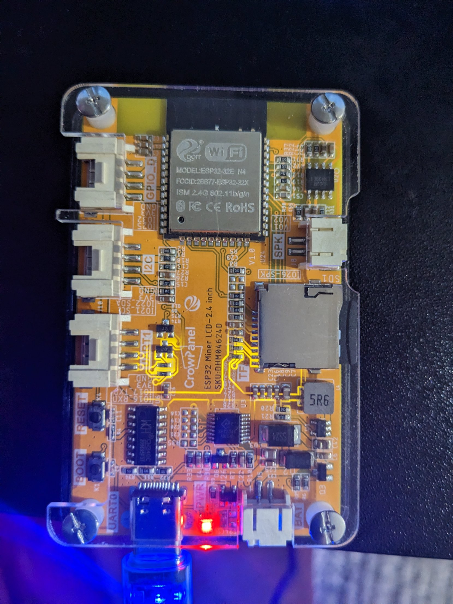
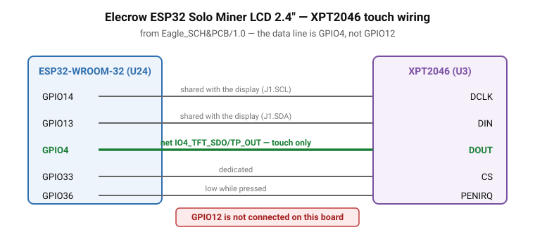
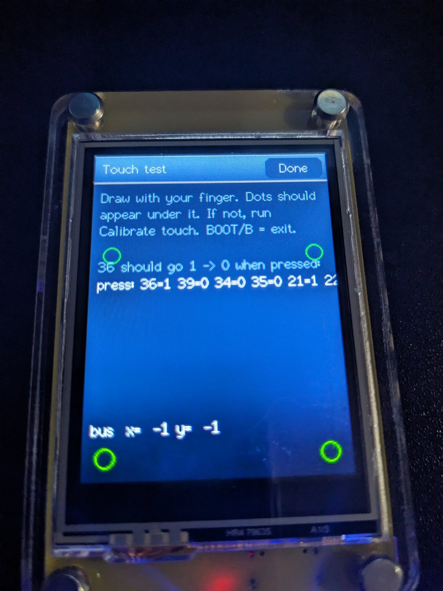

# Elecrow ESP32 Solo Miner LCD 2.4" — the touchscreen reads GPIO4, not GPIO12

**If the XPT2046 touch on your Elecrow 2.4" Solo Miner board returns nothing — all zeros, `getTouch()`
always false, `x = -1 y = -1`, the pen interrupt working but no coordinates — the data line is on
**GPIO4**. Almost every guide, config and example for these boards says GPIO12. On this board GPIO12 is
not connected to anything.**

This page exists because that one pin cost a full day of debugging, and because searching for it at the
time turned up nothing. Everything here was verified on real hardware.

| | |
|---|---|
| **Board** | Elecrow CrowPanel "ESP32 Miner LCD — 2.4 inch", hardware **V1.0** |
| **SKU on the PCB** | `DHM04624D` (Elecrow's wiki lists the model as `DHM05324D`) |
| **Sold as** | "2 PACK 2.4inch ESP32 Solo Miner LCD Display Cryptocurrency Solo Miner" |
| **Board family** | `WZ2432R024` / CrowPanel ESP32 HMI 2.4" |
| **Screen** | ILI9341V 240×320 SPI |
| **Touch** | XPT2046 resistive (comes with a stylus), on the display's SPI bus |
| **Ships with** | an LVGL demo built with TFT_eSPI; some units ship NMMiner instead |

## Is this your board?

<p align="center"></p>

Look at the silkscreen on the back: **CrowPanel**, **ESP32 Miner LCD—2.4 inch**, **SKU:DHM04624D**,
**V1.0**, with the ESP32-WROOM module marked `U24` and the touch controller `U3`. Connectors are labelled
GPIO_D, I2C, UART0, UART1, SPK, BAT and TF.

Elecrow document two V1.0 variants — plain, and one described as *"a green circular sticker on the back"* —
and give each its own example downloads. The board above has **no** green sticker.

## The fix

```
XPT2046 DCLK   -> GPIO14   (shared with the display)
XPT2046 DIN    -> GPIO13   (shared with the display)
XPT2046 DOUT   -> GPIO4    <-- not GPIO12
XPT2046 CS     -> GPIO33
XPT2046 PENIRQ -> GPIO36   (high at rest, low while pressed)
```

<p align="center"></p>

**TFT_eSPI** (`User_Setup.h`):

```c
#define TFT_MISO 4      // NOT 12 - the XPT2046's DOUT
#define TFT_MOSI 13
#define TFT_SCLK 14
#define TFT_CS   15
#define TFT_DC   2
#define TFT_RST  -1
#define TFT_BL   27
#define TOUCH_CS 33
#define SPI_TOUCH_FREQUENCY 600000
```

**LovyanGFX**:

```cpp
auto c = touch.config();
c.pin_sclk = 14;
c.pin_mosi = 13;
c.pin_miso = 4;      // NOT 12
c.pin_cs   = 33;
c.pin_int  = 36;
c.freq     = 600000;
c.bus_shared = true;
```

Set the **bus** MISO to 4 as well, not just the touch MISO. The display connector has no SDO pin at all, so
this bus's data input is only ever used by the touch chip.

**ESPHome**: `miso_pin: 4` in the `spi:` block.

## Why this is so hard to find

Elecrow's own published files disagree with each other, and all of the wrong ones are the easy ones to find:

| Source | Says the data pin is | Correct? |
|---|---|---|
| `Eagle_SCH&PCB/1.0/*.sch` (generated from the PCB) | **GPIO4** | ✅ |
| The shipped factory firmware binary | **GPIO4** | ✅ |
| `example/.../TFT_eSPI/User_Setup.h` | GPIO12 | ❌ |
| `example/V1.0/ESPHome/miner-hmi-28-24.yaml` | GPIO33 | ❌ |
| `example/V1.0_A_green.../ESPHome/2.4_ESPHome.yaml` | GPIO12 | ❌ |

Neither ESPHome config enables touch at all, and GPIO33 is the *chip select*, so those values were never
exercised by anyone. The GPIO12 value is inherited from the **CrowPanel ESP32 HMI 2.4"**, a board this one
otherwise matches pin for pin — same CLK, DIN, CS, PENIRQ, backlight, speaker and SD card pins. GPIO12 is
the one difference, and it is the one nobody changed.

## Why a wrong data pin looks exactly like a dead touch chip

This is the part that makes it expensive to debug. Every symptom points away from the real cause:

- **The pen interrupt works perfectly.** GPIO36 goes high→low the moment you press, so the chip is clearly
  powered, clearly sensing the panel, and clearly not the problem. It just can't tell you it was never asked.
- **Every read returns `00`**, through every driver — LovyanGFX, TFT_eSPI, raw Arduino `SPI.transfer()`, and
  direct register writes. An unconnected input pin reads the same as a chip that refuses to answer.
- **Sweeping the chip select finds nothing**, because the chip select was never wrong. Worse, GPIO4 is a
  natural thing to *include* in a chip-select sweep — and driving it as a push-pull output fights the very
  chip you are trying to read.
- **Driving GPIO12 high and low and reading it back works**, which looks like proof the line is healthy and
  the chip is mute. It actually means nothing is attached to it.

<p align="center"></p>

*What the failure looks like: the interrupt pin still reports, no coordinates ever arrive.*

## Proof, if you want it

The factory firmware is published as four `.bin` files, and it works. Disassembling its app image
(`LVGL_Arduino2.4RTP-CeShi-Hor.ino.bin`, IROM at `0x400d0020`) shows the sketch's own bus setup:

```
400d1f71:  movi.n  a14, 33     <- ss / touch CS
400d1f73:  movi.n  a13, 13     <- mosi
400d1f75:  movi.n  a12, 4      <- miso
400d1f77:  movi.n  a11, 14     <- sclk
400d1f79:  call8   400fdf90    <- begin(sclk, miso, mosi, ss)
```

On Xtensa, `call8` passes arguments in `a11`–`a15`, so that is `begin(sclk=14, miso=4, mosi=13, ss=33)`.
A second, identical call site sits next to immediates 18, 19, 23 and 5 — the SD card pins — which confirms
it as this board's setup code. GPIO12 appears nowhere near it.

So: the schematic, the absence of anything on GPIO12, and the working firmware's own instructions all agree.

## Restoring the stock firmware

Flashing Elecrow's `firmware.bin` on its own at `0x0` gives a **blank screen** — it is only the application
image. You need all four parts at their proper offsets:

```
0x1000   LVGL_Arduino2.4RTP-CeShi-Hor.ino.bootloader.bin
0x8000   LVGL_Arduino2.4RTP-CeShi-Hor.ino.partitions.bin
0xe000   boot_app0.bin
0x10000  LVGL_Arduino2.4RTP-CeShi-Hor.ino.bin
```

Or merge them into one image that flashes at `0x0`:

```bash
esptool.py --chip esp32 merge_bin -o stock-restore.bin \
  --flash_mode keep --flash_freq keep --flash_size keep \
  0x1000 *.ino.bootloader.bin 0x8000 *.ino.partitions.bin \
  0xe000 boot_app0.bin 0x10000 *.ino.bin
```

The stock partition table is `nvs` at `0x9000`, `otadata` at `0xe000`, `app0` at `0x10000` (3 MB),
`spiffs` at `0x310000`, `coredump` at `0x3f0000`.

## Links

- [Elecrow wiki — 2 PACK 2.4inch ESP32 Solo Miner LCD Display](https://www.elecrow.com/pub/wiki/2-PACK-2.4inch-ESP32-Solo-Miner-LCD-Display-Cryptocurrency-Solo-Miner.html)
- [Elecrow GitHub — schematics, examples, factory firmware](https://github.com/Elecrow-RD/2-PACK-2.4inch-ESP32-Solo-Miner-LCD-Display) — the schematic is `Eagle_SCH&PCB/1.0/`
- [Elecrow GitHub — CrowPanel 2.4" ESP32 HMI](https://github.com/Elecrow-RD/CrowPanel-2.4-ESP32-HMI-320x240) — the related board that *does* use GPIO12
- [This firmware's flasher](https://hackatnight.com/HAN-CYD-GBC/) — pick **Elecrow CrowPanel ESP32 2.4" / 2.8"**

---

<sub>Keywords: Elecrow Solo Miner 2.4 touch not working · ESP32 Miner LCD 2.4 inch · DHM04624D · DHM05324D ·
CrowPanel ESP32 HMI 2.4 · WZ2432R024 · XPT2046 not responding · XPT2046 returns 0 / all zeros ·
touchscreen no response ESP32 · TFT_eSPI getTouch false · TFT_MISO 12 wrong · LovyanGFX Touch_XPT2046 ·
TOUCH_CS 33 · PENIRQ GPIO36 works but no coordinates · IO4_TFT_SDO TP_OUT · ILI9341V · LVGL · NMMiner ·
Bitcoin solo miner display · Cheap Yellow Display · CYD · ESP32-2432S024R · resistive touch stylus ·
ESPHome miso_pin · blank screen after flashing firmware.bin</sub>
